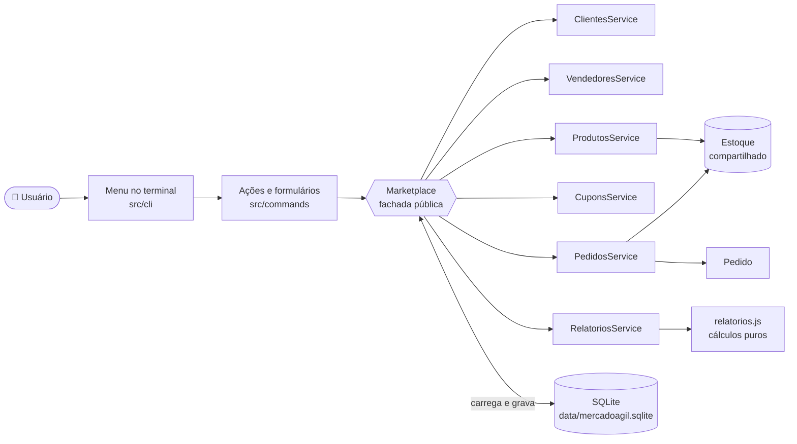
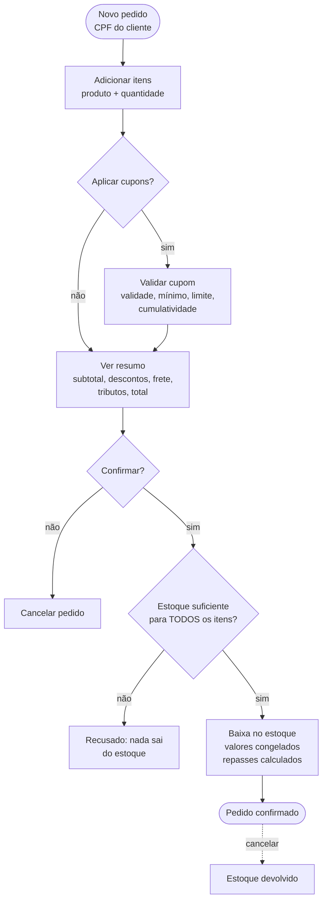
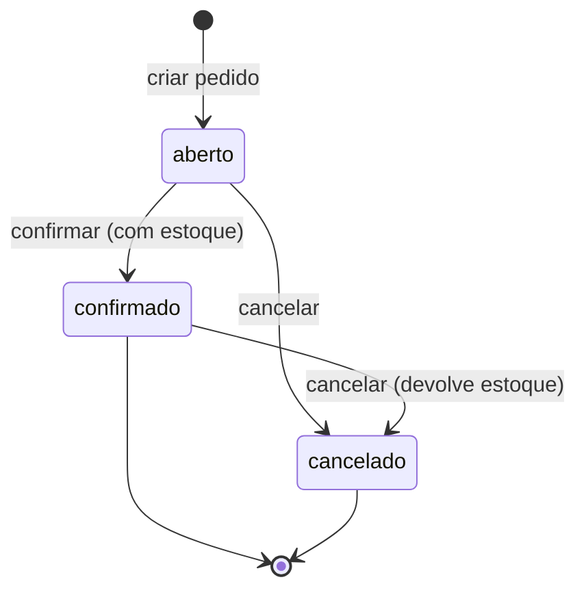

<div align="center">

# 🛒 MercadoÁgil

**Microsserviço de pedidos de marketplace, executado pelo terminal.**

Um pedido com vários vendedores: o sistema confere o estoque, aplica cupons, calcula frete, tributos e comissões, e informa o repasse de cada loja.


[Como executar](#-como-executar) · [Regras de negócio](#-regras-de-negócio) · [Menu](#-menu-e-ações) · [Persistência](#-persistência-e-privacidade) · [Contribuição](#-contribuição)

</div>

---

## 📑 Sumário

- [Visão geral](#-visão-geral)
- [Destaques](#-destaques)
- [Arquitetura](#-arquitetura)
- [Fluxo de um pedido](#-fluxo-de-um-pedido)
- [Regras de negócio](#-regras-de-negócio)
- [Exemplo de cálculo](#-exemplo-de-cálculo)
- [Como executar](#-como-executar)
- [Menu e ações](#-menu-e-ações)
- [Relatórios e filtros](#-relatórios-e-filtros)
- [Dados iniciais (seed)](#-dados-iniciais-seed)
- [Persistência e privacidade](#-persistência-e-privacidade)
- [Estrutura do projeto](#-estrutura-do-projeto)
- [Testes e qualidade](#-testes-e-qualidade)
- [Documentação](#-documentação)
- [Contribuição](#-contribuição)
- [Equipe](#-equipe)

---

## 🔭 Visão geral

O MercadoÁgil é um sistema de marketplace feito em **JavaScript** com **Node.js**, usando o terminal como interface. Ele foi desenvolvido pelo **SQUAD 4** como projeto final do Módulo 1.

Ele permite:

- cadastrar e manter **clientes**, **vendedores**, **produtos** e **cupons**;
- montar **pedidos** com vários vendedores e produtos;
- aplicar **cupons**, calcular **frete**, **descontos**, **tributos** e **comissões**;
- controlar o **estoque** de forma que um pedido só seja confirmado se todos os itens estiverem disponíveis;
- gerar **relatórios financeiros** com filtros por período, vendedor e cliente;
- guardar tudo em um banco **SQLite** local, sem precisar de servidor.

> **Para quem é:** quem quer entender como um pedido de marketplace é calculado, validado e persistido, do cadastro do cliente até o repasse ao vendedor.

---

## ✨ Destaques

| | Recurso | O que faz |
|:-:|---|---|
| 🧾 | **Pedido completo** | Itens, cupons, frete, tributos, total e repasse calculados sempre do mesmo jeito |
| 📦 | **Estoque tudo ou nada** | Ao confirmar, todos os itens são conferidos. Se faltar um, nada sai do estoque |
| 🎟️ | **Cupons com regras** | Validade, valor mínimo, limite de 2 por pedido, teto de 30% em descontos e cupons não cumulativos |
| 🚚 | **Frete por região** | Taxa da região + R$ 1,50 por unidade, grátis a partir de R$ 300 ou com cupom de frete |
| 💰 | **Repasse por loja** | Valor dos itens de cada vendedor menos a comissão da categoria |
| 📊 | **Relatórios** | Faturamento, ticket médio, categorias, repasses, top produtos, com filtros |
| 🔒 | **Privacidade** | CPF fica fora das respostas exibidas (LGPD) |
| 💾 | **Dados que sobrevivem** | Cada operação é gravada no SQLite. Reabrir o programa mantém pedidos e estoque |
| 🛡️ | **Validação com Zod** | Dado inválido é recusado, com mensagem em português que diz o que corrigir |

---

## 🏗️ Arquitetura

O menu conversa **somente** com a classe `Marketplace`. Ela distribui o trabalho entre os serviços e grava o estado no SQLite.



**Ideias principais**

- **Uma fachada.** A CLI só chama métodos públicos do `Marketplace`. Os serviços ficam escondidos.
- **Serviços independentes.** Cada serviço guarda sua coleção em um campo privado. As consultas entre serviços são passadas pelo construtor como funções.
- **Estoque compartilhado.** Produtos e pedidos usam o mesmo objeto `Estoque`, dentro de cada instância do `Marketplace`.
- **Respostas padronizadas.** Toda operação devolve `{ ok: true, dados }` ou `{ ok: false, erros: [...] }`.

Detalhes completos em [docs/arquitetura.md](docs/arquitetura.md).

---

## 🔄 Fluxo de um pedido



---

## 📐 Regras de negócio

As taxas ficam em [`src/config/regras.js`](src/config/regras.js). Os valores abaixo são os do código atual.

### Frete

| Região de entrega | Taxa base |
|---|---:|
| Norte | R$ 35,00 |
| Nordeste | R$ 25,00 |
| Centro-Oeste | R$ 30,00 |
| Sudeste | R$ 20,00 |
| Sul | R$ 22,00 |

**Fórmula:** `taxa da região + R$ 1,50 × unidades do pedido`

**Frete grátis** quando o pedido tem um cupom do tipo `frete`, ou quando o valor **depois dos descontos** chega a **R$ 300,00**. Um frete por pedido, mesmo com vendedores diferentes.

### Tributos e comissão

Calculados sobre o **valor dos itens**, antes de descontos e frete, por categoria:

| Categoria | Tributo | Comissão do marketplace |
|---|---:|---:|
| Eletrônicos | 12% | 8% |
| Livros | 0% | 15% |
| Alimentos | 5% | 10% |
| Vestuário | 8% | 12% |
| Casa | 10% | 10% |

Tributos são **informativos**: aparecem no resumo, mas não entram no total pago pelo cliente.

### Repasse ao vendedor

```
repasse = valor bruto dos itens do vendedor − comissão desses itens
```

Cupom e frete são custo do marketplace, então **não diminuem o repasse**.

### Cupons

| Regra | Comportamento |
|---|---|
| Tipos | `percentual` (ex.: 10% do subtotal), `fixo` (ex.: R$ 15,00) e `frete` (zera a entrega) |
| Validade | Só cupom com data futura. Cupom vencido é recusado |
| Valor mínimo | O subtotal dos produtos precisa atingir o mínimo do cupom |
| Limite | Até **2 cupons** por pedido |
| Duplicidade | O mesmo cupom não entra duas vezes no mesmo pedido |
| Não cumulativo | Só pode ser usado sozinho (ex.: `FRETEZERO`) |
| Teto | Os descontos nunca passam de **30%** do subtotal |

### Estoque

- A checagem acontece na **confirmação**, para todos os itens de uma vez (**tudo ou nada**).
- Se faltar qualquer item, a mensagem lista **todos** os itens em falta.
- Confirmar dá **baixa** no estoque. Cancelar um pedido **confirmado** devolve os itens.
- Adicionar o mesmo produto de novo **soma** a quantidade no item.

### Estados do pedido



- Pedido **aberto** pode receber itens e cupons.
- Pedido **confirmado** ou **cancelado** não aceita mais alterações.
- Pedido **confirmado** guarda uma cópia dos dados de cliente, produtos, cupons e valores. Editar o cadastro depois **não** muda o histórico.

### Exclusões protegidas

| Não pode excluir | Enquanto houver |
|---|---|
| Cliente | Pedido aberto dele |
| Produto | Pedido aberto com ele |
| Cupom | Pedido aberto que o aplica |
| Vendedor | Produtos cadastrados dele |

---

## 🧮 Exemplo de cálculo

Pedido de **Maria Santos** (região Nordeste), com **Mouse** (R$ 120,00) e **Livro de JavaScript** (R$ 80,00), cupons **BEMVINDO10** (10%) e **PDA15** (R$ 15,00):

| Linha | Valor | Como é calculado |
|---|---:|---|
| Subtotal | R$ 200,00 | 120 + 80 |
| Descontos | − R$ 35,00 | BEMVINDO10: 10% de 200 = 20 · PDA15: 15 |
| Frete | + R$ 28,00 | Nordeste 25 + 2 unidades × 1,50 |
| **Total pago pelo cliente** | **R$ 193,00** | 200 − 35 + 28 |
| Tributos (informativo) | R$ 14,40 | Mouse: 12% de 120. Livro: 0% |

**Repasses após a confirmação:**

| Vendedor | Bruto | Comissão | Repasse |
|---|---:|---:|---:|
| TechBahia | R$ 120,00 | R$ 9,60 | **R$ 110,40** |
| Livraria Sol | R$ 80,00 | R$ 12,00 | **R$ 68,00** |

> Os valores acima são os produzidos pelo código com os dados iniciais. Eles servem para conferir a implementação.

---

## 🚀 Como executar

### Requisitos

- **Node.js 22.13 ou superior** (o banco usa o módulo nativo `node:sqlite`)
- **npm**

Os testes deste README foram executados com o Node.js **22.23.4**.

### Passo a passo

```bash
git clone https://github.com/azevaldo/mercadoagil-squad-4.git
cd mercadoagil-squad-4
npm install
npm start
```

Na **primeira execução**, o sistema:

1. cria o banco `data/mercadoagil.sqlite`;
2. carrega os dados iniciais de [`src/data/seed.js`](src/data/seed.js);
3. mostra avisos, se algum dado inicial não passar na validação.

### Navegação

| Tecla | Ação |
|---|---|
| `↑` / `↓` | Move a seleção |
| `Enter` | Abre uma categoria ou executa uma ação |
| `Esc` | Volta ao menu anterior |
| `Ctrl+C` | Encerra o programa |
| `/voltar` | Cancela o preenchimento de um formulário |

Em terminais sem teclas interativas (ou com `TERM=dumb`), o menu usa **opções numeradas**. Use `0` para voltar ou sair.

### Voltar aos dados iniciais

Feche o programa e apague `data/mercadoagil.sqlite`. Ele será recriado na próxima execução.

---

## 🧭 Menu e ações

```
Menu principal
├── 🧾 Pedidos
│   ├── Novo pedido · Adicionar item · Remover item
│   ├── Aplicar cupom · Remover cupom
│   ├── Ver resumo · Confirmar · Cancelar
│   └── Listar pedidos
├── 📇 Cadastros
│   ├── Clientes     → cadastrar, listar, buscar, atualizar, excluir
│   ├── Vendedores   → cadastrar, listar, buscar, atualizar, excluir
│   ├── Produtos     → cadastrar, listar, buscar, atualizar, excluir
│   └── Cupons       → cadastrar, listar, buscar, atualizar, excluir
├── 📊 Relatórios
│   └── Financeiro · Faturamento por categoria · Repasse · Top 3 produtos
└── Sair
```

### Tabela de ações

| Nº | Ação | Área |
|---:|---|---|
| 1 | Cadastrar cliente | Cadastros › Clientes |
| 2 | Listar clientes | Cadastros › Clientes |
| 3 | Buscar cliente | Cadastros › Clientes |
| 4 | Atualizar cliente | Cadastros › Clientes |
| 5 | Excluir cliente | Cadastros › Clientes |
| 6 | Cadastrar vendedor | Cadastros › Vendedores |
| 7 | Listar vendedores | Cadastros › Vendedores |
| 8 | Buscar vendedor | Cadastros › Vendedores |
| 9 | Atualizar vendedor | Cadastros › Vendedores |
| 10 | Excluir vendedor | Cadastros › Vendedores |
| 11 | Cadastrar produto | Cadastros › Produtos |
| 12 | Listar produtos | Cadastros › Produtos |
| 13 | Atualizar produto | Cadastros › Produtos |
| 14 | Buscar produto | Cadastros › Produtos |
| 15 | Excluir produto | Cadastros › Produtos |
| 16 | Cadastrar cupom | Cadastros › Cupons |
| 17 | Listar cupons | Cadastros › Cupons |
| 18 | Buscar cupom | Cadastros › Cupons |
| 19 | Atualizar cupom | Cadastros › Cupons |
| 20 | Excluir cupom | Cadastros › Cupons |
| 21 | Novo pedido | Pedidos |
| 22 | Adicionar item ao pedido | Pedidos |
| 23 | Remover item do pedido | Pedidos |
| 24 | Aplicar cupom ao pedido | Pedidos |
| 25 | Ver resumo do pedido | Pedidos |
| 26 | Confirmar pedido | Pedidos |
| 27 | Cancelar pedido | Pedidos |
| 28 | Listar pedidos | Pedidos |
| 29 | Relatório financeiro | Relatórios |
| 30 | Faturamento por categoria | Relatórios |
| 31 | Repasse por vendedor | Relatórios |
| 32 | Top 3 produtos mais vendidos | Relatórios |
| 33 | Remover cupom do pedido | Pedidos |

Os formulários mostram exemplos e uma ajuda para cada campo. Dados como CPF e CNPJ aceitam pontuação ou só os números.

---

## 📈 Relatórios e filtros

Os relatórios consideram **apenas pedidos confirmados**. Pedidos abertos ou cancelados não entram.

| Filtro | Como funciona |
|---|---|
| **Data inicial / final** | Formato `AAAA-MM-DD`. Filtra pela data de **confirmação**, no fuso de São Paulo. As duas datas entram no período |
| **Vendedor** | Nome ou CNPJ. Inclui o pedido se **pelo menos um item** for dessa loja |
| **Cliente** | CPF, nome ou e-mail. Busca parcial, sem diferenciar maiúsculas |

> **Atenção:** o filtro de vendedor escolhe **pedidos**, não itens. O pedido entra inteiro, com os valores de todas as lojas que aparecem nele.

Os cálculos ficam em [`src/services/relatorios.js`](src/services/relatorios.js), e o filtro em [`RelatoriosService`](src/services/marketplace/RelatoriosService.js).

---

## 🌱 Dados iniciais (seed)

O seed em [`src/data/seed.js`](src/data/seed.js) é carregado só na primeira execução (ou depois de apagar o banco).

| Tipo | Itens |
|---|---|
| **Clientes** | Maria Santos (Nordeste), Joao Lima (Sul), Ana Costa (Sudeste) |
| **Vendedores** | TechBahia, Livraria Sol, Casa Verde |
| **Produtos** | Mouse, Livro de JavaScript, Teclado Mecânico, Fone Bluetooth, Livro de Algoritmos, Café Especial, Camiseta de Algodão, Caneca de Cerâmica |
| **Cupons** | `BEMVINDO10` (10%, mínimo R$ 100), `PDA15` (R$ 15 fixo, mínimo R$ 150), `FRETEZERO` (frete grátis, não cumulativo). Todos válidos até 2030 |

---

## 🔐 Persistência e privacidade

### Banco SQLite

O banco fica em `data/mercadoagil.sqlite`, criado a partir de [`data/schema.sql`](data/schema.sql). O arquivo **não é enviado ao GitHub** (está no `.gitignore`).

| Tabela | Conteúdo |
|---|---|
| `metadados` | Estado inicializado, revisão e contadores de ids |
| `clientes` | Cadastro de clientes (com CPF) |
| `vendedores` | Cadastro de vendedores (CNPJ) |
| `produtos` | Produtos, preço, categoria, vendedor e **quantidade em estoque** |
| `cupons` | Cupons cadastrados |
| `pedidos` | Pedidos, com dados congelados na confirmação |
| `itens_pedido` | Itens de cada pedido |
| `cupons_pedido` | Cupons aplicados em cada pedido |

**Como a gravação funciona:** cada operação bem-sucedida regrava o estado completo dentro de uma transação. Uma revisão numerada impede que duas sessões sobrescrevam uma à outra: quem gravar depois recebe a mensagem de que os dados mudaram e recarrega.

### Privacidade (LGPD)

- As **respostas** do sistema não mostram o CPF do cliente.
- O CPF é guardado **apenas** no banco, para identificar o cliente internamente.
- A listagem de pedidos e os relatórios não exibem CPF.

---

## 🗂️ Estrutura do projeto

```text
mercadoagil-squad-4/
├── index.js                     Ponto de entrada: abre o banco e inicia o menu
├── data/
│   └── schema.sql               Estrutura das tabelas SQLite
├── docs/
│   ├── arquitetura.md           Como os serviços se conectam
│   └── padroes-de-desenvolvimento.md
├── scripts/
│   └── verificar-terminal.js    Verificação do terminal (usa CLI_TEST_TOOLS)
├── src/
│   ├── cli/                     Menu, teclado, formulários e resultados
│   ├── commands/                Ações do menu, formulários e apresentação
│   ├── config/regras.js         Frete, tributos, comissões, teto e limites
│   ├── data/                    Seed e acesso ao SQLite
│   ├── models/                  Cliente, Vendedor, Produto, Estoque, Pedido, Cupom
│   ├── schemas/                 Validações com Zod
│   ├── services/                Marketplace (fachada), serviços e relatórios
│   └── utils/                   Dinheiro, respostas e funções auxiliares
└── test/                        29 arquivos de teste
```

### Schemas do Zod

| Arquivo | Valida |
|---|---|
| [`clienteSchema.js`](src/schemas/clienteSchema.js) | Nome, e-mail, CPF com dígitos verificadores e região |
| [`vendedorSchema.js`](src/schemas/vendedorSchema.js) | Nome da loja, CNPJ com dígitos verificadores e e-mail |
| [`produtoSchema.js`](src/schemas/produtoSchema.js) | Nome, preço, categoria, quantidade e CNPJ do vendedor |
| [`cupomSchema.js`](src/schemas/cupomSchema.js) | Código, tipo, valor, validade futura e percentual até 100% |
| [`itemPedidoSchema.js`](src/schemas/itemPedidoSchema.js) | Quantidade do item (inteiro, maior que zero) e número do pedido |
| [`validar.js`](src/schemas/validar.js) | Função auxiliar que devolve `{ ok, dados }` ou `{ ok, erros }` |

---

## 🧪 Testes e qualidade

| Comando | O que faz |
|---|---|
| `npm test` | Roda os testes com `node --test` |
| `npm run lint` | Verifica o código com ESLint |
| `npm run format:check` | Verifica a formatação com Prettier |
| `npm run format` | Aplica a formatação |
| `npm run check` | Roda a verificação de formatação e o lint |

**Situação na versão deste README** (Node.js 22.23.4):

- ✅ **216 testes** em 18 suítes, todos passando.
- ✅ **Lint** sem erros.
- ⚠️ **Formatação:** `npm run format:check` aponta **22 arquivos** fora do padrão. Rode `npm run format` antes de abrir um Pull Request.

Os testes cobrem, entre outros: cadastros e validações, pedidos e itens, cupons, estoque, relatórios, persistência no SQLite, recuperação após falha e sessões simultâneas.

---

## 📚 Documentação

| Documento | Conteúdo |
|---|---|
| [CONTRIBUTING.md](CONTRIBUTING.md) | Como preparar o ambiente, criar branches, fazer commits e abrir Pull Requests |
| [docs/arquitetura.md](docs/arquitetura.md) | Responsabilidade de cada serviço e como o estado é salvo |
| [docs/padroes-de-desenvolvimento.md](docs/padroes-de-desenvolvimento.md) | Nomes, formatação, classes, validação, privacidade, regras de negócio e checklist de testes |
| [src/config/regras.js](src/config/regras.js) | Todas as taxas e limites do sistema |
| [data/schema.sql](data/schema.sql) | Estrutura do banco |

### Links no GitHub

Os links abaixo apontam para a branch `main`. Se a branch padrão for outra, troque `main` pelo nome dela.

- 📄 [Código-fonte](https://github.com/azevaldo/mercadoagil-squad-4/tree/main/src)
- 🧪 [Testes](https://github.com/azevaldo/mercadoagil-squad-4/tree/main/test)
- 🏛️ [Arquitetura](https://github.com/azevaldo/mercadoagil-squad-4/blob/main/docs/arquitetura.md)
- 📐 [Regras de negócio](https://github.com/azevaldo/mercadoagil-squad-4/blob/main/src/config/regras.js)
- 🗄️ [Schema do banco](https://github.com/azevaldo/mercadoagil-squad-4/blob/main/data/schema.sql)
- 🐛 [Issues](https://github.com/azevaldo/mercadoagil-squad-4/issues)
- 🔀 [Pull Requests](https://github.com/azevaldo/mercadoagil-squad-4/pulls)

---

## 🤝 Contribuição

1. Crie uma branch **a partir da `dev`**, com nome curto e descritivo:
   ```text
   feature/busca-cliente
   fix/validacao-cupom
   docs/readme
   ```
2. Faça commits pequenos, no padrão `tipo: descrição`:
   ```text
   feat: adiciona busca de vendedores
   fix: corrige validação de cupom
   test: cobre criação de pedido
   ```
3. Antes de abrir o Pull Request, rode `npm test`, `npm run format` e `npm run lint`.
4. Abra um **Pull Request para `dev`**, explique a mudança e os testes feitos, e peça revisão de outro integrante.

Mais detalhes em [CONTRIBUTING.md](CONTRIBUTING.md).

---

## 👥 Equipe

**SQUAD 4 · Acelera Dev T8**

| Integrante |
|---|
| Agnes Costa |
| Ariely Paim |
| Azevaldo Caluaco |
| Pedro Silva |
| David Silva |
| Irlan Cordeiro |

Projeto final do Módulo 1 · entrega em 28/10/2026.

---

<div align="center">

Feito com 💛💙 pelo SQUAD 4

</div>


A divisão das responsabilidades do Marketplace está descrita em [docs/arquitetura.md](docs/arquitetura.md).
